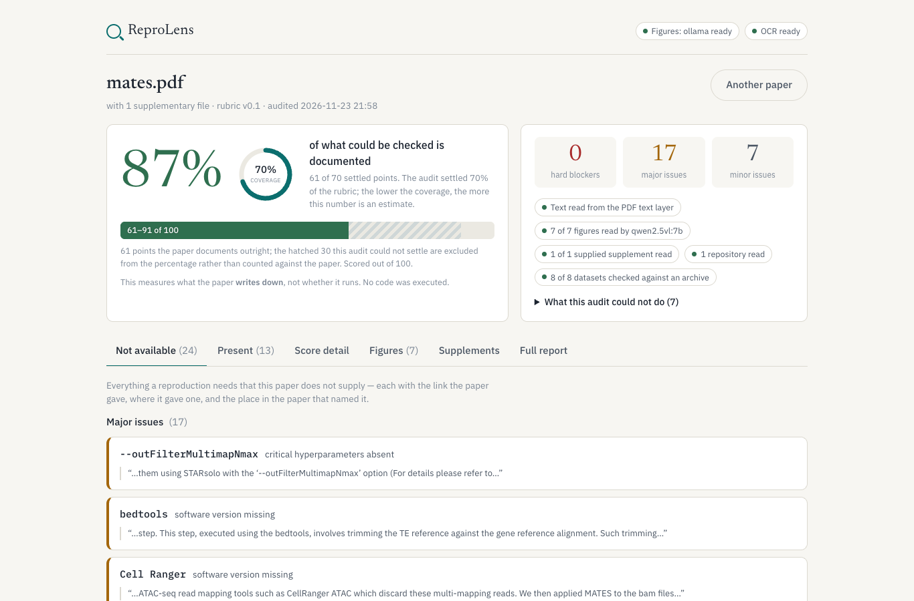
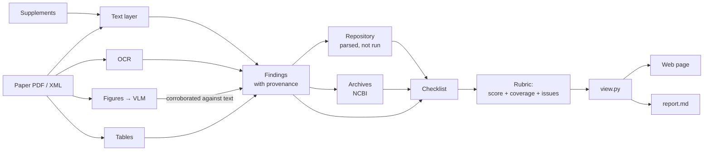

# ReproLens

**What would reproducing this paper take?** Drop in a scientific paper and
ReproLens reads its text, scanned pages, figures, tables and supplements, the
code repository it points at and the data archives it cites. It then reports
what a reproduction needs, what the paper never says, and where it said each
thing: document, page, section and quote.



It scores what is *documented*, not whether the code runs: nothing in a paper,
or in any repository it points at, is ever executed.

## Quickstart

**Docker**

```bash
docker build -t reprolens .
docker run --rm -p 8765:8765 -e OLLAMA_HOST=http://host.docker.internal:11434 reprolens
# open http://localhost:8765
```

Figures are read by a vision model that is not in the image: either an
[Ollama](https://ollama.com) on the host (`ollama pull qwen2.5vl:7b`), or Claude
with `-e REPROLENS_VLM=anthropic -e ANTHROPIC_API_KEY=…`. With neither, the
page says figures were not read and the rest of the audit runs.

**Locally** (Python 3.11, [uv](https://docs.astral.sh/uv/), `brew install tesseract`)

```bash
uv sync
ollama pull qwen2.5vl:7b && ollama serve &
uv run python -m app.server                     # http://localhost:8765
```

**Command line**

```bash
uv run python audit.py paper.pdf --supplement S1_Table.xlsx --out output/
# output/<paper>/report.md      the report
# output/<paper>/links.json     every finding, with provenance
# output/<paper>/assessment.json  score, coverage, issues
```

## What it reads

| Channel | How | What it finds |
|---|---|---|
| Text | PyMuPDF text layer, or JATS XML | accessions, repositories, DOIs, tools, versions, parameters, section by section |
| Scanned pages | Tesseract OCR, run for pages with no text layer | the same, from page images |
| Figures | cropped from the page, read by a vision model (Qwen2.5-VL via Ollama, or Claude) | tools and identifiers visible only in a figure; each one checked against the text |
| Tables | row and cell extraction | values that appear only in tables |
| Supplements | PDF, XLSX, CSV/TSV, DOCX, TXT dropped beside the paper | version tables and Methods detail moved to the supplement |
| Repository | cloned, then parsed with `ast` and manifest readers, never run | declared dependencies, commands, which script makes which figure |
| Archives | NCBI E-utilities (GEO, SRA, BioProject) | whether each dataset actually exists |

## How it works



- **`audit.py`** runs the pipeline. **`app/server.py`** (FastAPI) runs it as a
  subprocess per upload, streams its progress to the browser over server-sent
  events, and deletes every upload when the job ends.
- **`reprolens/reporting/view.py`** is the one place presentation rules live,
  so the web page and the Markdown report cannot disagree about an audit.

## Design rules

- **Fail closed.** A channel that did not run is reported as not run, never
  as "found nothing". A scanned paper with OCR missing says *not read*, not
  *no datasets*. Every channel's status is on the result page.
- **One number, never without its coverage.** The score is the share of what
  could be settled that the paper documents. Below 50% coverage there is no
  score at all, because it would describe the audit rather than the paper.
- **Trust nothing the model can't back up.** An identifier the vision model
  reads off a figure counts only when the text names it too. Otherwise it is
  flagged as unverified.
- **Provenance on everything.** Each finding carries its document, page,
  section and quote.
- **Nothing is executed and nothing is kept.** Repositories are parsed, not
  run. Uploads live in a temporary directory. Figures are read locally by
  default. No user identity is sent to NCBI. Archive bot gates are respected,
  not evaded.

## Results

Graded by `check.py` against Tier-1 ground truth: two papers the author's lab
spent months actually reproducing (LocusMasterTE, MATES). The app never sees
these records; `tests/test_no_benchmark_leak.py` enforces that.

| | LocusMasterTE | MATES |
|---|---|---|
| Ground-truth accessions and repositories found | 3 / 3 | 5 / 5 |
| Rubric criteria inside the app's band | 7 / 7 | 6 / 7 |
| Hard blockers (app / annotators) | 1 / 1 | 0 / 0 |
| Major problems (app / annotators) | 5 / 1 | 6 / 3 |

The app reports more major problems than the annotators, by design and partly
by limitation. The annotators recorded the blockers that cost them time; the
app reports every documented gap, including tools that are only named as
comparators. Two papers is a small benchmark. Three more (ALIGNN, ASPEN,
atomate2) have worksheets in `benchmark/worksheets/` awaiting annotation.

Also measured:

- **OCR:** on rasterised pages, 3.7k–4.7k characters per page at 0.88–0.94
  confidence.
- **Vision cache:** a SQLite cache keyed by model, prompt and image hash takes
  a 7-figure paper from about 3 minutes to about 7 seconds on a repeat run.
- **Tests:** 479 tests, run in CI with OCR installed.

## Limitations

- The software vocabulary is a curated list. A tool the list doesn't know is
  not checked for a version.
- Tables are read as cells. The app can tell a value appears in Table 3 but
  not which column heading governs it.
- PDFs carry no supplement manifest, so the supplements have to be supplied by
  hand. The publishers' bot gates are not bypassed.
- Whether the Methods describe every preprocessing choice is left undetermined
  rather than guessed.

## Project layout

```
audit.py                 the pipeline (CLI)
check.py                 the grader -- the only code that reads benchmark/
app/                     FastAPI server and the web page
reprolens/documents/     PDF, JATS, OCR, figures, tables, supplements, sections
reprolens/discovery/     identifier patterns, roles, archive resolution
reprolens/extraction/    tool/version checklist, vision models
reprolens/repository/    fetch, inventory, manifests, static analysis
reprolens/graph/         script -> data -> figure dependency graph
reprolens/scoring/       the rubric
reprolens/reporting/     view model and Markdown report
benchmark/               ground truth (Tier 1) and worksheets (Tier 2)
docs/design-notes.md     why each rule is the way it is
```

## Development

```bash
uv sync --extra dev
uv run pytest -q
uv run ruff check . && uv run ruff format --check .
uv run python check.py                    # grade against the benchmark
```

The journal PDFs are not redistributable, so `data/papers/` is gitignored; the
tests that need them skip without them. [`docs/design-notes.md`](docs/design-notes.md)
has the full engineering record, and
[`ReproLens_Project_Blueprint.md`](ReproLens_Project_Blueprint.md) the original
plan.
